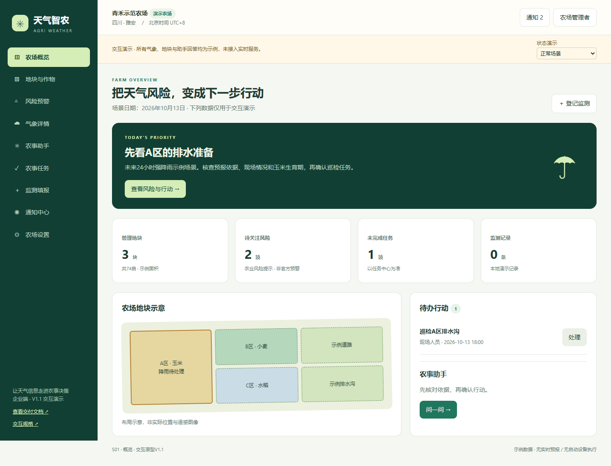
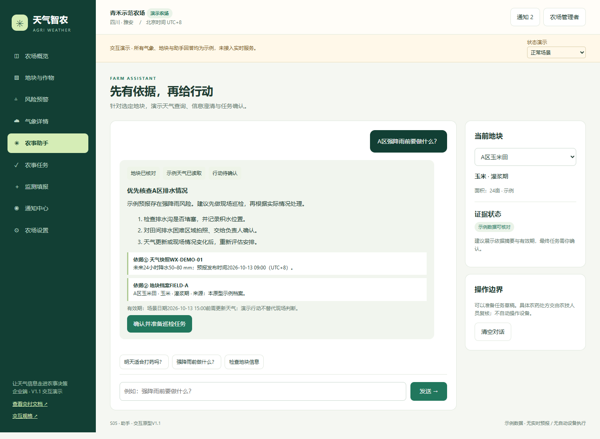

# 天气智农产品评审资料

企业端MVP · V1.1 · 2026-10-13

## 阅读入口

- [需求文档PDF](PRD.pdf)：产品范围、功能契约、Agent协议和验收标准。
- [交互规格PDF](interaction-spec.pdf)：页面、组件、状态和Figma/Axure重建规格。
- [评测报告PDF](evaluation.pdf)：现有源码基线、指标口径与待测结果。
- [40条用例CSV](evaluation-cases.csv) / [JSONL](evaluation-cases.jsonl)：产品与Agent测试输入。
- [界面验收记录](verification.html)：19项本地浏览器检查全部通过。

## 体验交互原型

下载本目录全部文件，打开index.html，再进入prototype.html。无需联网或安装依赖。GitHub文件预览不会直接运行HTML。

推荐路线：概览 → 风险详情 → 农事助手 → 确认任务 → 执行反馈 → 监测填报。顶部状态控制可切换缺生育期、天气过期、服务超时与空数据场景。

演示账号：admin / password。任务、监测与生育期修改保存在浏览器本地，可导出JSON或在设置中重置。

## 版本与依据

依据源码版本[33cf9da](https://github.com/aed68372-max/111/tree/33cf9da8a82ee4253a962ebe75eb1e4d1fb8722a)整理；新增助手和任务流程属于产品设计。HTML/CSS为可编辑内容，PDF为评审版。Figma .fig与Axure .rp未包含在本版中。

示例气象、指标与固定脚本回答仅用于界面演示；真实Agent、后端及设备服务未连接。40条效果用例均为待测，不将19项界面检查当作模型效果。

## 预览

## 文件

index.html / PRD.html / prototype.html / interaction-spec.html / evaluation.html / verification.html / document.css / evaluation-cases.csv / evaluation-cases.jsonl / verification-results.json / previews/
